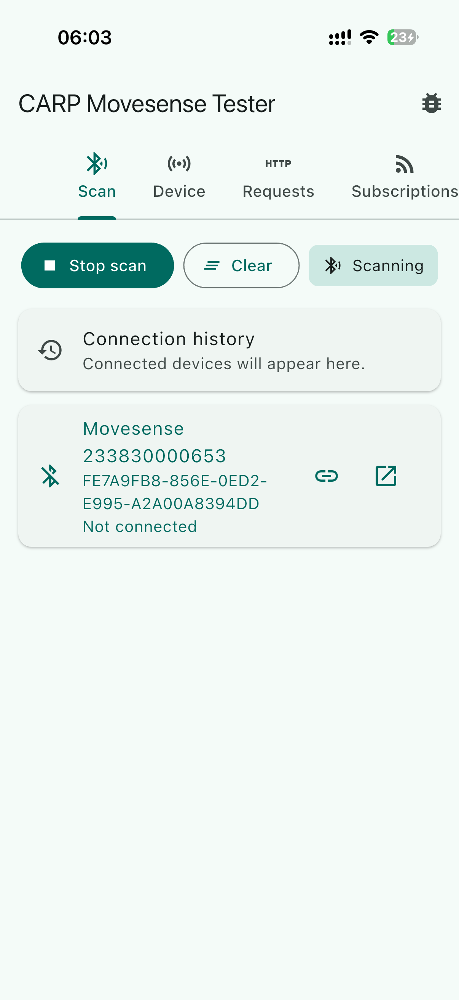
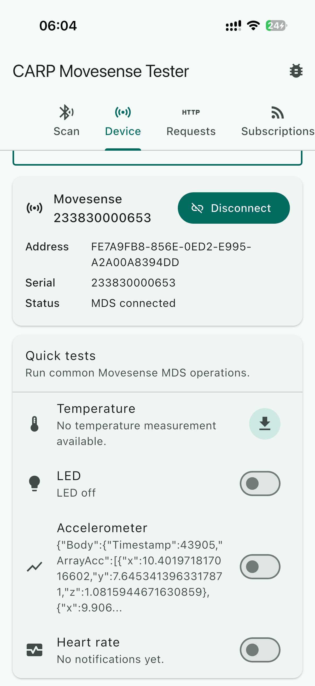
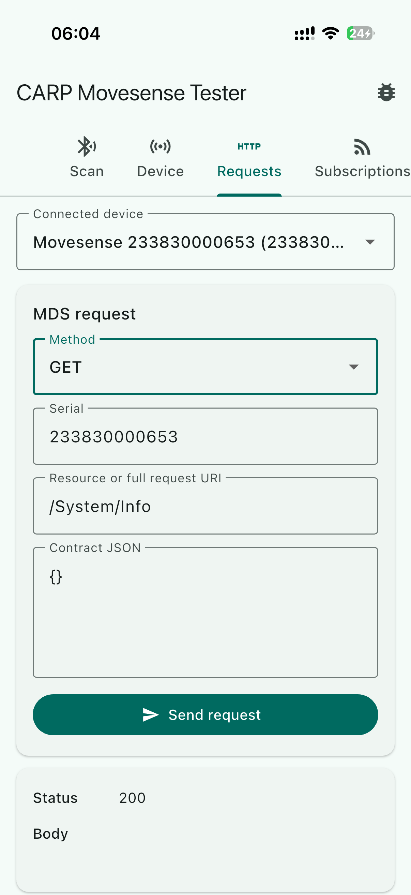
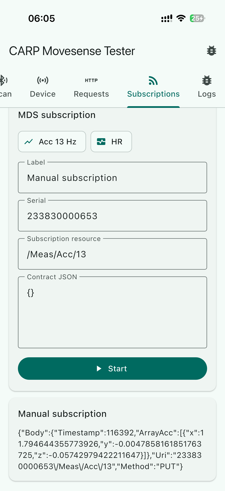
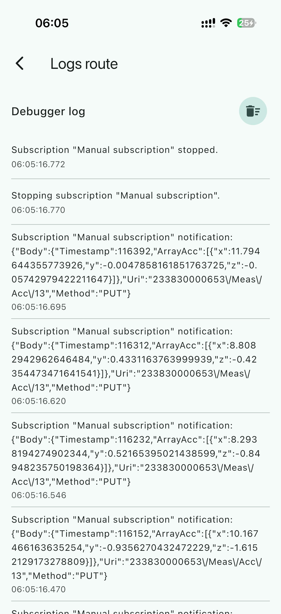

# CARP Movesense Flutter

A Flutter plugin for Movesense devices made by [CARP](https://carp.dk).

## API shape

The primary API is `CarpMovesenseFlutter`, exported from
`package:carp_movesense_flutter/carp_movesense_flutter.dart`.

It supports:

- BLE scan start/stop and scan result stream.
- Connect/disconnect by Android MAC address or Apple UUID.
- MDS `GET`, `PUT`, `POST`, and `DELETE` requests.
- MDS subscriptions as Dart streams.

The package also exports `Mds` and `MdsAsync` compatibility wrappers for code
migrating from `mdsflutter`.

## Example App

The `example/` folder contains a simple Flutter app that demonstrates the plugin's API. This app is a good starting point for integrating the plugin into your own app.

| Scan | Device | Request | Subscriptions | Logs |
|:---:|:---:|:---:|:---:|:---:|
|  |  |  |  |  |


## Contribution

The plugin uses [Pigeon](https://pub.dev/packages/pigeon) for typed Dart/native transport. So for any changes to the native code, run `tool/generate_pigeon.sh` to regenerate the bindings after making changes.

Generated bindings are always written under `gen/` folders:

- `lib/src/gen/pigeon/`
- `android/src/main/kotlin/dk/carp/carp_movesense_flutter/gen/`
- `ios/carp_movesense_flutter/Sources/carp_movesense_flutter/gen/`
- `macos/carp_movesense_flutter/Sources/carp_movesense_flutter/gen/`

Pigeon contracts live in `pigeons/` and are split by responsibility:

- `carp_movesense_api.dart` for platform metadata.
- `carp_movesense_scan_*` for BLE scan commands and callbacks.
- `carp_movesense_connection_*` for connection commands and callbacks.
- `carp_movesense_request_*` for MDS request commands and responses.
- `carp_movesense_subscription_*` for subscriptions and notifications.

Regenerate after editing a contract:

```sh
tool/generate_pigeon.sh
```

The original callback message schema has been ported to
`protos/carp_movesense_mds.proto` for reference and interoperability. Runtime
Flutter/native transport uses Pigeon DTOs instead of protobuf byte arrays.

## Movesense SDKs

Android uses the vendored Movesense `mdslib` AAR under `android/vendor`.

iOS uses the vendored `MovesenseMDS.xcframework` under `ios/carp_movesense_flutter/Vendor`. For iOS you can build the `xcframework` yourself using the Movesense SDK and the `tool/generate_movesense_mds_xcframework.sh` script. The framework must be signed with a valid certificate. See the script for details.

You can get the compiled Movesense SDK from cloning the [movesense-mobile-lib](https://bitbucket.org/movesense/movesense-mobile-lib/src/master/) at `https://bitbucket.org/movesense/movesense-mobile-lib/src/master/IOS/Movesense/Release-iphoneos/` (iOS) and `https://bitbucket.org/movesense/movesense-mobile-lib/src/master/android/Movesense/` (Android).

macOS registers the same Pigeon channels but returns unsupported errors for
Movesense operations because no macOS Movesense MDS binary is bundled.
